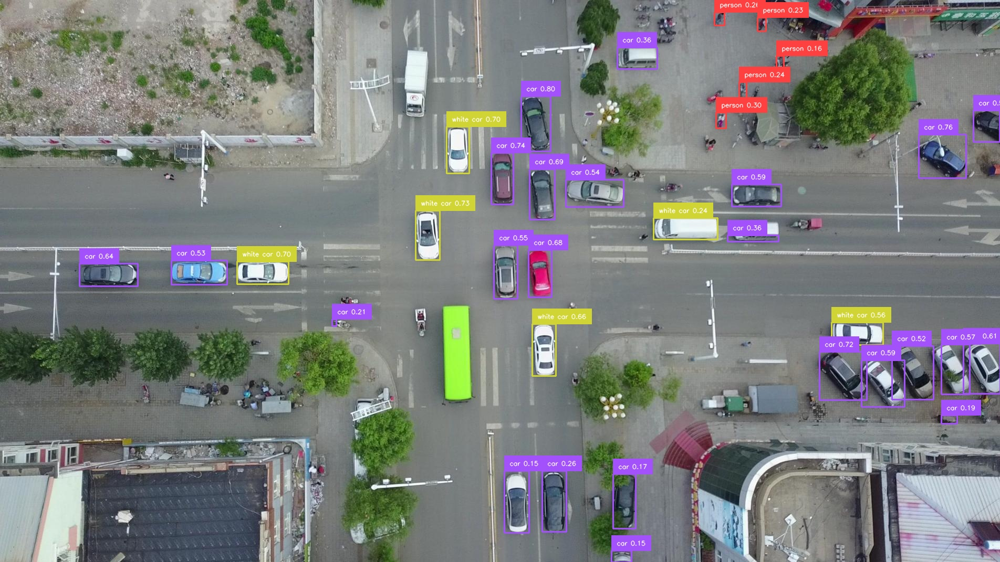
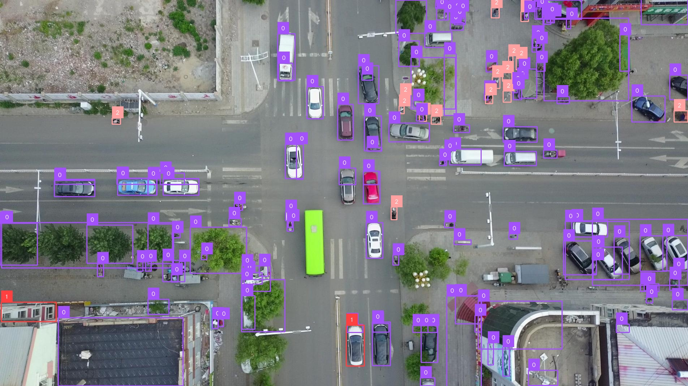

#  Drone City Detector

This repository contains a pragmatic, high-recall object detection pipeline designed specifically for high-resolution drone imagery in urban environments. 

Given the strict 5-hour time constraint and the restriction against training or annotating, this solution leverages Zero-Shot Object Detection and Inference Slicing to achieve robust results across multiple diverse classes out-of-the-box.
Here is the updated **Architecture & Methodology** section for your `README.md`, incorporating the hybrid logic, specific class improvements, and the transition to Grounding DINO.
## Architecture & Methodology

This project employs a hybrid AI pipeline designed for high-resolution zenith-view drone imagery, developed within a 5-hour constraint.

### 1. Dual-Model Strategy
* **YOLOv8-World (Production Baseline):** Selected for high inference speed and efficiency. It serves as the primary engine for rigid objects like cars and people.
* **Grounding DINO (Experimental Pivot):** Integrated to address complex, amorphous classes (trees, trash). As a Transformer-based model with cross-modality attention, it "grounds" linguistic prompts into visual features more deeply than standard vision models.


### 2. Engineering Enhancements
* **Inference Slicing (SAHI):** To prevent small-object "pixel-loss" during downsampling, I implemented an overlapping 640x640 tiling strategy. This ensures tiny subjects like pedestrians and motorbikes remain detectable at native resolution.
* **Hybrid Color Logic:** To solve the semantic ambiguity of "white car" prompts, I implemented a post-processing **HSV color filter**. This uses objective pixel data to verify car colors, bypassing neural network hallucinations.
* **Class-Agnostic NMS:** Used to deduplicate overlapping predictions across tile boundaries and resolve conflicts between semantically similar prompts.

### 3. Standards & Reproducibility
* **Docker & uv:** Full containerization with fast dependency resolution ensures a "ready-to-run" environment with pre-cached model weights.

### 4. Technical Analysis
While Grounding DINO offers superior semantic potential for "trash" and "canopies," the current implementation yields a high false-positive rate. The **YOLO + HSV Hybrid** remains the recommended production-ready solution due to its balance of speed and attribute accuracy.
## Getting Started

The application is fully containerized. You only need Docker installed.

### 1. Build the Docker Image
Weights are pre-downloaded during build to ensure the container is ready for immediate offline inference.
```
docker build -t drone-city-detector .
```
### 2. Run the Detector
Create a local results directory and run the container. This command uses a volume mount to ensure the output image is saved to your host machine.

#### Run YOLO
```
docker run --rm -v "${PWD}/data:/app/data" -v "${PWD}/results:/app/results" drone-city-detector --image data/image.jpg
```

#### Run DINO
```
docker run --rm -v "${PWD}/data:/app/data" -v "${PWD}/results:/app/results" drone-city-detector --model dino --image data/image.jpg --output results/dino_test.jpg --conf 0.40
```

## Output
### YOLO


### DINO


## CLI Arguments
* --image: Path to input image.
* --model: Model to run the detection YOLO or DINO
* --output: Path for the annotated image.
* --conf: Confidence threshold.

## Conclusions and Technical Analysis

### 1. YOLOv8-World Implementation
* **Baseline Selection**: I chosed `YOLOv8-World` as the initial detector due to its high inference speed and computational efficiency, which are critical for real-time drone-edge applications.
* **Hybrid Vision Approach**: To resolve semantic confusion between "car" and "white car," I implemented a post-processing pipeline using classical computer vision (HSV color filtering) to verify car colors based on objective pixel data.
* **Precision Slicing**: By utilizing `InferenceSlicer` to tile the 1904x1071 image into smaller 640x640 patches, I successfully improved the recall of small objects like "persons" that are often lost during standard image downsampling.

### 2. Architectural Pivot: Grounding DINO
* **Addressing Amorphous Classes**: Since YOLO struggled with texture-based classes like "trees," "motorcycles," and "trash," I pivoted to **Grounding DINO**.
* **Deep Semantic Fusion**: Grounding DINO was selected because it uses a Transformer-based architecture with cross-modality attention, allowing it to "ground" linguistic concepts (e.g., "tree canopy") into image features more effectively than pure vision models.

* **Experimental Status**: While I successfully integrated the DINO pipeline and bypassed library compatibility issues (manually handling Transformer tensors), the results currently show a high rate of false positives. Due to time constraints, I could not complete the fine-tuning of box and text thresholds required to refine these detections.